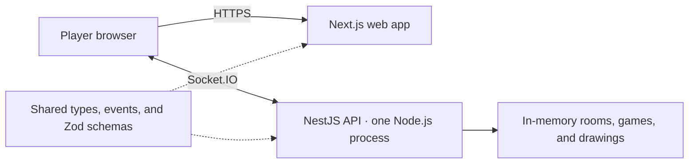

# Draw & Guess

Draw & Guess is a browser-based drawing and guessing game for two to eight players. Share a room code or invitation link, take turns drawing secret words, and guess before the timer runs out. The game synchronizes strokes and scores live, shows final standings after two rounds, and lets the host replay in the same room.

## Stack and architecture



- **Web** — Next.js App Router, TypeScript, Tailwind CSS, shadcn/ui, React Konva, Zustand, and Socket.IO Client.
- **API** — NestJS, TypeScript, Socket.IO, and Zod. The server owns membership, turns, timers, and scoring.
- **Tooling** — pnpm Workspaces, ESLint, Prettier, Husky, and GitHub Actions.

```text
apps/
  api/          NestJS services, gateways, and tests
  web/          Next.js routes, game features, socket client, and browser tests
packages/
  shared/       Event contracts, payload schemas, and types
docs/           Architecture, deployment, and benchmark notes
```

Read the [architecture guide](docs/architecture.md) for service responsibilities, reconnection, and state synchronization. [DESIGN.md](DESIGN.md) records the UI layout guidelines.

## Local setup

Install Git, Node.js **24 LTS**, and pnpm **12.21.0**. From the repository root on Windows:

```powershell
npm install --global pnpm@12.21.0
pnpm install --frozen-lockfile
Copy-Item apps/web/.env.example apps/web/.env.local
Copy-Item apps/api/.env.example apps/api/.env
pnpm dev
```

On macOS or Linux, use `cp` for the two environment files. Open [http://localhost:3000](http://localhost:3000). Check API readiness at [http://localhost:3001/health](http://localhost:3001/health).

For separate terminals, first run `pnpm --filter @draw-and-guess/shared build`, then run the package commands below. Use `start` in place of `dev` to run compiled apps after `pnpm build`. The example files supply the explicit loopback values needed for a local production build.

```powershell
pnpm --filter @draw-and-guess/api dev
pnpm --filter @draw-and-guess/web dev
```

| Command                           | Purpose                                                |
| --------------------------------- | ------------------------------------------------------ |
| `pnpm dev`                        | Build the shared package, then watch all packages.     |
| `pnpm build`                      | Build the shared package, NestJS, and Next.js.         |
| `pnpm typecheck`                  | Build shared declarations and check all packages.      |
| `pnpm lint` / `pnpm format:check` | Check lint rules and formatting.                       |
| `pnpm format`                     | Format files. The pre-commit hook checks staged files. |

## Environment

| Package | Variable                 | Local value             | Hosted value                                                                                  |
| ------- | ------------------------ | ----------------------- | --------------------------------------------------------------------------------------------- |
| Web     | `NEXT_PUBLIC_SOCKET_URL` | `http://localhost:3001` | API HTTPS origin. Set before building because Next.js embeds this public value in the client. |
| API     | `NODE_ENV`               | `development`           | `production`                                                                                  |
| API     | `PORT`                   | `3001`                  | Provider-assigned port. Render supplies this automatically.                                   |
| API     | `FRONTEND_URL`           | `http://localhost:3000` | Exact canonical frontend HTTPS origin, including any non-default port.                        |
| API     | `MAX_ACTIVE_ROOMS`       | `128`                   | Optional positive limit per process, up to 1,024.                                             |
| API     | `MAX_SOCKET_CONNECTIONS` | `1536`                  | Optional Engine.IO connection limit per process, from 2 to 8,192.                             |

Keep local environment files out of Git. The web build and production API require explicit origins. HTTP is supported for explicit loopback checks. Use HTTPS for public origins, and keep credentials, paths, queries, and fragments out of both origin values.

## Game and Socket.IO

The host starts with at least two connected players. The server runs `waiting → word_selection → drawing → turn_summary`, then starts the next eligible turn or moves to `finished`. The host can choose **Play Again** to return everyone to the same lobby.

| Events                                                             | Purpose                                                                    |
| ------------------------------------------------------------------ | -------------------------------------------------------------------------- |
| `room:create`, `room:join`, `room:rejoin`, `room:leave`            | Manage membership. `room:updated` and `room:closed` synchronize the lobby. |
| `game:start`, `game:get-state`, `game:state`, `game:restart`       | Start, restore, synchronize, or replay a game.                             |
| `word:options`, `word:choose`, `word:confirmed`                    | Privately offer and confirm the drawer's choice.                           |
| `draw:start`, `draw:points`, `draw:end`, `draw:clear`, `draw:sync` | Send drawing previews, commit strokes, clear, and recover the canvas.      |
| `guess:submit`, `guess:message`, `guess:player-correct`            | Submit guesses and synchronize public activity and scores.                 |

See [shared event contracts](packages/shared/src/events.ts) for payloads and acknowledgement types.

## Testing

Build first for the API tests. The connection and gameplay integration tests also need a running API. For alternate local endpoints, set `FRONTEND_URL` and `NEXT_PUBLIC_SOCKET_URL` in the test terminal.

```powershell
pnpm build
pnpm --filter @draw-and-guess/api exec node --test
pnpm --filter @draw-and-guess/web test:drawing-client
pnpm --filter @draw-and-guess/web test:security
pnpm --filter @draw-and-guess/web test:connection
pnpm --filter @draw-and-guess/web test:rooms
pnpm --filter @draw-and-guess/web test:game
pnpm --filter @draw-and-guess/web test:drawing
pnpm --filter @draw-and-guess/web test:guessing
pnpm --filter @draw-and-guess/web test:lifecycle
pnpm --filter @draw-and-guess/web test:isolation
```

The live security test starts and restarts its own API on port 3103. Set `SECURITY_TEST_PORT` to use another free port.

### Browser verification

Run both apps and use separate browser profiles to create and join a room. Play through two rounds, refresh during drawing, and verify Results and Play Again. With Chrome installed, the automated browser tests exercise these flows, mobile viewports, and touch emulation.

```powershell
$qa = Join-Path $env:TEMP 'draw-guess-browser-tests'
npm install --prefix $qa --no-save playwright-core@1.65.1
$env:PLAYWRIGHT_PACKAGE_DIR = $qa
pnpm --filter @draw-and-guess/web test:e2e
```

Set `QA_CHROME_PATH` for a custom Chrome executable. See [performance benchmarks](docs/performance.md) for load-test commands and historical results.

## Production and troubleshooting

The [deployment runbook](docs/deployment.md) covers Vercel and a single Render API, exact environment settings, manual release, and the multiplayer acceptance checklist.

| Symptom                                   | What to check                                                                                                                          |
| ----------------------------------------- | -------------------------------------------------------------------------------------------------------------------------------------- |
| Build fails with an environment error     | Configure `NEXT_PUBLIC_SOCKET_URL` in the web build environment and `FRONTEND_URL` on the production API. Both values must be origins. |
| Web app opens but cannot connect          | Check API `/health`, the built API origin, and the exact frontend origin. Run `test:connection` against those two endpoints.           |
| Polling works but WebSocket fails         | Check that the proxy preserves the WebSocket upgrade on `/socket.io/`. Inspect the browser's Network panel for a WSS connection.       |
| An invitation stops working               | Check that the room still exists and that the API process has not restarted. Create a new room if state was lost.                      |
| Several users see rate or capacity errors | Check `MAX_ACTIVE_ROOMS`, `MAX_SOCKET_CONNECTIONS`, and whether users share one proxy peer budget.                                     |

Rooms, drawings, scores, and reconnect credentials live in memory. An API restart or redeploy clears them. Lobby invitations expire when the room closes, and offline members have 15 seconds to reconnect. Mobile browser automation uses Chromium emulation. Physical phones and Safari's software keyboard still need acceptance testing.
