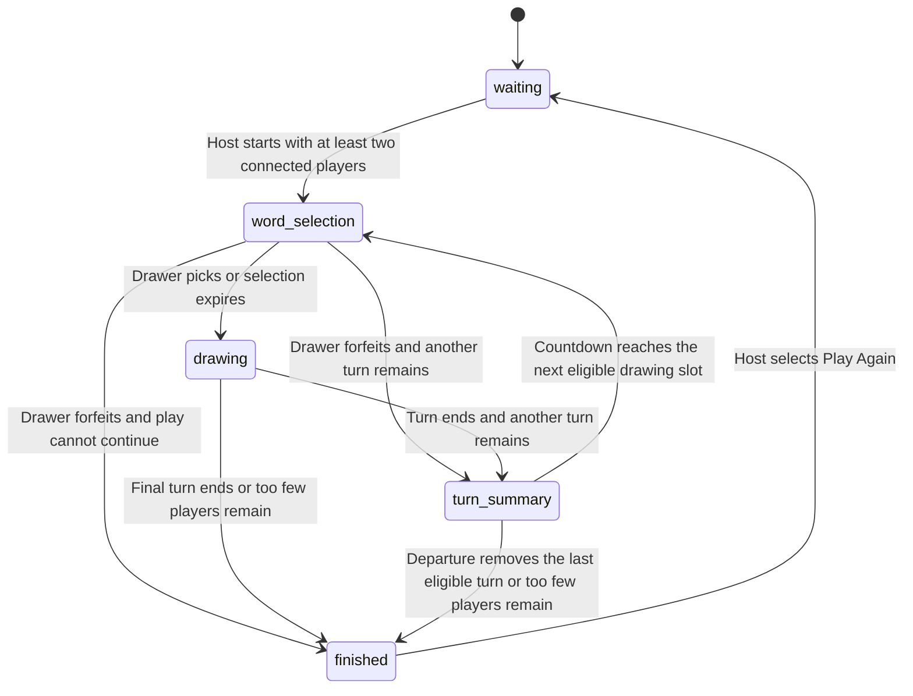

# Architecture

## Services and contracts

| Component                | Responsibility                                                                                                                                                                                                                             |
| ------------------------ | ------------------------------------------------------------------------------------------------------------------------------------------------------------------------------------------------------------------------------------------ |
| `RoomsService`           | Owns room codes, membership, host authority, lobby generations, socket bindings, and reconnect credentials. Closes empty rooms and signals dependent services to release their state.                                                      |
| `GameService`            | Owns the game roster, active drawer, secret words, deadlines, guess validation, scores, turn rotation, summaries, final standings, and Play Again.                                                                                         |
| `DrawingService`         | Authorizes drawing against the active drawer and turn, bounds preview and stroke history, applies clears, and builds snapshots. Finalizes the received part of an interrupted stroke.                                                      |
| Socket.IO gateways       | Validate payloads with shared Zod schemas, call services with the actual socket identity, and send acknowledgements, room broadcasts, or private drawer events. `SocketIoAdapter` enforces the origin, packet size, and connection budget. |
| `@draw-and-guess/shared` | Defines event names, request schemas, acknowledgement types, DTOs, and drawing constants. Its compiled output is used by both apps.                                                                                                        |

The HTTP health controller and Socket.IO share one listening port. Nest services store active state in memory. Each browser connects directly from the web app to the API. No database, background worker, or cross-instance adapter is required.

## State and timers

The server schedules two rotations of the initial roster. Members who leave permanently lose future slots and retain earned points. The server gives the drawer three private options and 15 seconds to choose. On timeout it picks the first option. Drawing lasts up to 60 seconds. Between turns, a five-second summary reveals the answer when one was selected and shows awards. When no further turn can be played, the server publishes final standings immediately. Replay keeps the room and membership while the next start creates a new game with zero scores.

Each active game has one timer for its current phase. It publishes absolute deadlines and server time for the browser countdown. A timer verifies the game and revision before changing state. Closing a room or stopping the API cancels its timers. Revision, game, and turn identifiers protect against stale actions and snapshots.

## Membership and reconnect

Players get an opaque ID and reconnect credential. The browser stores the credential in `sessionStorage` for that tab. When a socket drops, the server temporarily retains membership for 15 seconds. `room:rejoin` rebinds the identity to a new socket and can replace an old connection. The frontend requests the authorized game view and drawing snapshot as needed. Rejoining preserves the original turn, word options, and deadline.

If the host leaves or their grace period expires, ownership transfers to the next connected member. Drawer departure or expiry ends the current turn as a forfeit. The API releases all room and game state once the last membership ends. Restarted instances start empty.

## Privacy and scoring

The drawer gets options and the selected answer through private events or an authorized restore response. The public drawing-phase view contains a mask. Correct-guess broadcasts carry a generic notice and score changes. The submitting player gets their own award in the acknowledgement. Compound guesses containing word-bank candidates use the same public masking rule for every candidate.

The first correct answer per player earns `100 + 5 × ceil(remainingMs / 1000)`. The drawer earns 50 points per correct guesser, up to 200 in a turn. Request receipts and eligibility checks prevent duplicate awards. A bounded guess history supports reconnect. Final ranks share a place for tied scores and preserve roster order within ties.

Nicknames and guess text render as text. Service-side membership controls action permissions. Before a public release, verify the reverse proxy behavior described in the [deployment runbook](deployment.md).

Socket.IO accepts packets up to 16 KiB. Each direct peer has a ten-second budget of 256 handshakes, 32 room creation requests, 128 joins, and 64 reconnect requests. Each budget tracks up to 4,096 peers and reclaims expired entries. A player can burst four guesses and recovers one per 500 ms. A separate pre-validation socket budget protects guess parsing.

## Web client and drawing

The client reuses one Socket.IO connection per tab across route transitions. `room-client.ts` restores membership and applies versioned room snapshots to `room-store.ts`. `game-client.ts` applies phase snapshots, private word events, score changes, and chat updates to `game-store.ts`. Feature hooks subscribe to the slices they render. Visual countdowns tick locally.

React Konva draws on a 900 × 600 logical canvas. The drawer renders immediately and batches preview points about every 24 ms. A reliable final stroke repairs skipped previews. Snapshots restore completed strokes after reconnect. Clearing advances the canvas version, so old packets cannot replay ink. The server bounds history to 256 completed strokes or 24,576 points per canvas, with a separate turn budget that persists across clears.

For exact wire payloads, see [events.ts](../packages/shared/src/events.ts) and [schemas.ts](../packages/shared/src/schemas.ts). For test setup, see the [README](../README.md#testing).
